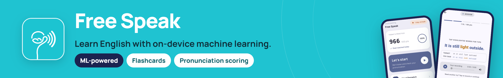
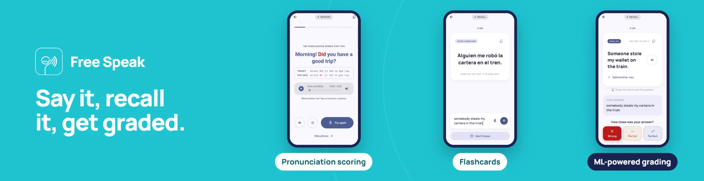

<p align="center">
  
</p>
<p align="center">
  <a href="LICENSE"></a>
  <a href="https://play.google.com/store/apps/details?id=com.gersonhmg.freespeak"></a>
</p>


FreeSpeak brings ML-powered Anki flashcards and English speech practice directly to your phone. It is built for learners who want a personalized experience powered by smart tools.

## What it does

<p align="center">
  
</p>

- **Recall cards.** A native-language prompt, and you type or say the English.
  Cards come back on a spaced schedule. Make your own decks, or start from the
  premade ones (common phrases, travel, food, work, phrasal verbs, idioms).
- **Pronunciation.** Read a sentence, and each word is checked against what
  the recognizer heard, down to the individual sounds. Tap a word to hear it,
  slowed down or syllable by syllable.
- **Progress.** Cards per day, a streak, a year of activity, and the words
  you keep getting wrong.


## Building

You need Flutter 3.47 or newer (stable channel) and the Android SDK and NDK
that Flutter uses. The Flutter project is in `app/`.

```bash
cd app
flutter pub get
flutter run
```

The models are checked in (about 100 MB of them), so a first build needs no
extra downloads, and the APK is large for the same reason.

`app/android/app/src/main/jniLibs/*/libptts_ffi.so` is a prebuilt Phonon runtime
(arm64-v8a and x86_64), built from a fork of the ptts Rust project. Its source
and build steps are not in this repository yet.

Android is the supported platform. The `ios/`, `macos/` and `web/` folders in `app/` are
Flutter's defaults and have not been tried.

## Tests

```bash
cd app
flutter test
```

The database tests run on the desktop through `sqflite_common_ffi`. eSpeak
only runs on a device, so `app/test/espeak_fixture_test.dart` replays output
captured on a phone and skips itself while that fixture is empty.

## Open problems

Three parts of FreeSpeak work, but not as well as they should. If you want to
help, these are the best places to start. Each link explains how the part is
built today.

### Pronunciation scoring

The recording goes through speech recognition, and the words it heard are
compared, sound by sound, with the sentence.
[How it works →](app/docs/pronunciation_scoring.md)

- A mispronounced sound is only caught if the recognizer writes down a
  different word. If it hears *tink* but writes *think*, the error is missed.
- Sentences with numbers score low: *2:30* in the sentence becomes
  *two thirty* from the recognizer.
- US English only.
- Scoring the sounds straight from the audio was tried and dropped. A
  method that works on a phone is still wanted.

### Text to speech

The voice runs on the phone, and the times of its words are read from inside
the model. [How it works →](app/docs/tts_system.md)

- The voice reads text, not phonemes, so it can say a word differently from
  the pronunciation the app shows and scores against.
- Word times are off by about 70 ms on average, and syllables are guessed
  from the audio's loudness.
- Not yet measured on a phone, and older ARM phones can't run it.
- The word timing lives in a fork of the voice's runtime that isn't
  published yet.

### Recall grade suggestion

After a Recall answer, the app suggests Wrong, Partial or Perfect by
comparing the wording with the card's known answers.
[How it works →](app/docs/recall_grade_suggestion.md)

- A correct answer worded differently gets no suggestion, or even *Wrong*.
  The planned fix is a meaning check with sentence embeddings.
- Similar words are forgiven too easily: *station* and *state*, or *ship*
  and *shop*.
- Recognition errors in spoken answers count as wording mistakes.
- English only.

## Acknowledgements

FreeSpeak runs on the work of these projects:

- [Phonon](https://gradium.ai/phonon) by Gradium: the voice that reads
  sentences aloud.
- [Vosk](https://alphacephei.com/vosk/) by Alpha Cephei: offline speech
  recognition.
- [Kaldi](https://kaldi-asr.org) and [OpenFst](https://www.openfst.org): the
  speech toolkit and the finite-state library under Vosk.
- [eSpeak-NG](https://github.com/espeak-ng/espeak-ng): turning text into the
  phonemes the app shows and scores against.

## Licence

FreeSpeak is free software under the **GNU General Public License v3**; see
[`LICENSE`](LICENSE). It links eSpeak-NG, which is GPL v3, so the app is too;
[`packages/espeak_ng/LICENSE.md`](app/packages/espeak_ng/LICENSE.md) explains the
choice.

Third-party parts keep their own licences:

- eSpeak-NG and its data: GPL v3, with parts under Apache-2.0, BSD-2 and the
  Unicode licence.
- Kaldi and OpenFst: Apache-2.0.
- The Vosk English model: Apache-2.0.
- The Phonon model and the ptts runtime: Apache-2.0 / MIT.
- The Manrope font: SIL Open Font License 1.1.
